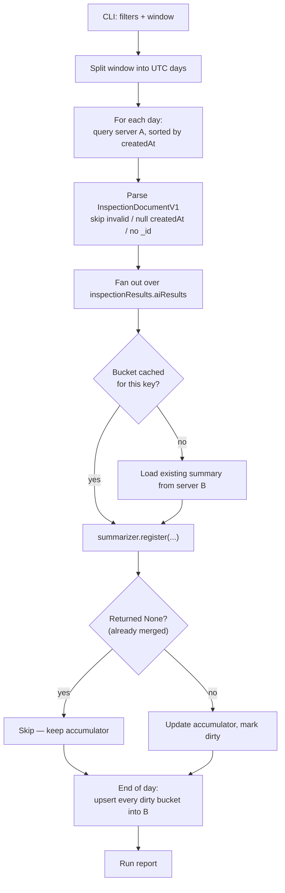

# Inspection Summarizer — Documentation

Reads **inspection documents** from a MongoDB collection on **server A**, folds them
into **inspection summary documents**, and creates or updates those summaries in a
collection on **server B**.

---

## 1. What was implemented

A self-contained Python package. It has no dependency on `cosmo_data` — every schema,
enum and utility it needs is defined inside the project.

```
inspection-summarizer/
├── main.py                            entry point
├── requirements.txt                   pydantic >= 2.7, pymongo >= 4.6
└── inspection_summarizer/
    ├── config.py                      ← connection constants YOU fill in
    ├── cli.py                         argument parsing, verify / run commands
    ├── pipeline.py                    day loop, bucket folding, run report
    ├── summarizer.py                  the conversion itself (verbatim port)
    ├── repositories.py                read from A, upsert into B
    ├── db.py                          per-server MongoDB connection
    ├── filters.py                     InspectionFilter → MongoDB query
    ├── keys.py                        the summary document key
    ├── common/
    │   ├── constants.py               ModelTasks, InspectionMode, UploadStatus
    │   └── datetime_util.py           day truncation, day-window iteration
    └── schemas/
        ├── base.py                    DataModel: snake_case ↔ camelCase storage
        ├── inspections.py             InspectionDocumentV1 and its tree
        └── summary.py                 InspectionSummaryDocumentV1 and its tree
```

| Module | Responsibility |
|---|---|
| `config.py` | Host / port / credentials / database / collection for both servers, plus behaviour defaults. The only file you edit. |
| `db.py` | One `MongoConnection` per server. Deliberately **not** a singleton — two independent servers are involved. Uses synchronous pymongo with `tz_aware=False`. |
| `filters.py` | `InspectionFilter` — every filter you can apply, and the translation into a MongoDB query using the stored camelCase field paths. |
| `keys.py` | `SummaryKey`, the 6-field identity of a summary document, and its upsert filter. |
| `repositories.py` | `InspectionRepository` (read-only on A) and `SummaryRepository` (find + upsert on B, plus the unique index). |
| `summarizer.py` | The conversion logic, ported verbatim from the reference implementation. |
| `pipeline.py` | Orchestration: walk the window day by day, group inspections into buckets, fold, write once per bucket, produce a run report. |
| `cli.py` | The `verify` and `run` commands and all their flags. |

### Deviations from the reference schemas

Two, both deliberate:

1. **`elapsedTime` is typed `float`**, not `PositiveFloat`. A single `0.0` in production
   data would otherwise raise a `ValidationError` and abort the batch.
2. **`aiResults` is a discriminated union on `task`** rather than a plain union. Smart
   union would usually resolve it correctly; the discriminator makes it deterministic.
   `ai_result.task == ModelTasks.CLASSIFICATION` behaves identically.

`summarizer.py` is otherwise byte-for-byte the reference implementation with only the
import paths changed. Its behaviour is a contract with anything else reading the summary
collection — changing it means regenerating the affected summaries.

---

## 2. The conversion

### One summary document per key

```
modelName + modelVersion + gbm + process + mode + date
```

`date` is the **UTC day start** of the source inspection's `metadata.createdAt`. A
summary for `2026-06-20` therefore covers every matching inspection created in
`[2026-06-20 00:00:00, 2026-06-21 00:00:00)`.

`modelName` and `modelVersion` come from splitting `aiModel` on its **last** slash:

```
"sidetopsideu8000/sidetopsideu8000_260316_260316081905"
 └── modelName ──┘ └────────── modelVersion ──────────┘
```

### Fan-out, then fan-in

One inspection produces **one summary per entry in `inspectionResults.aiResults`**, and
many inspections fold into the same summary:

```
inspection (2 aiResults)          summary documents
┌─────────────────────┐
│ epoxycls/v1         │──────────▶ epoxycls/v1 | SEVT/Active | test | 2026-06-20
│ sidebottom/v2       │──────────▶ sidebottom/v2 | SEVT/Active | test | 2026-06-20
└─────────────────────┘                    ▲
                                           │
        other inspections, same day/model ──┘
```

### Accumulation

| Field | Behaviour |
|---|---|
| `statistics.dataCount["totalCount"]` | +1 per **prediction** (per image/patch) |
| `statistics.dataCount[className]` | classification: +1 per prediction · detection: +1 per **bounding box** · segmentation: not tracked |
| `statistics.confidence[className]` | running `sum`, `min`, `max`; `avg` recomputed as `sum / count` on every merge |
| `statistics.elapsedTime` | same, over `totalCount` |
| `classes` | union of every `aiResult.classes` seen |
| `threshold` | first non-null found when the summary is **created**; never revisited |
| `inspectionIds` | every absorbed inspection id — this is what makes merging idempotent |

Worked example — inspection 1 has 10 `Good` + 20 `Scratch`, inspection 2 has 10 `Good` +
30 `Scratch`:

```
statistics.dataCount = { "totalCount": 70, "Good": 20, "Scratch": 50 }
inspectionIds        = [ "<id1>", "<id2>" ]
```

Because `sum` and the counts are both persisted, averages survive a reload from server B
and never drift.

### Samples

Per class, at most `--max-samples-per-class` (default 3) representative predictions are
kept. Selection: predictions **with human feedback win outright** (newest first if there
are enough), then the pool is ranked as *lowest confidence, highest confidence, then
closest to the average* — the two extremes plus the most typical. Existing samples are
re-pooled and re-ranked on every merge, so a stored sample can be evicted later.

A prediction can only become a sample if its `fileIndex` is set **and** points inside
`fileList`. Predictions failing that still count toward every statistic.

> **In the data seen so far, `fileIndex` is `null` and `fileList` is `[]`, so `samples`
> stays `{}` and summaries are purely statistical.** This is the reference behaviour,
> kept intentionally. The run report counts these under `predictions not sampleable` so
> you can see the scale.

---

## 3. Workflow



**Why day by day.** `date` is part of the key, so a day boundary partitions the key space
cleanly. Every bucket touched inside one day is loaded once, folded over every matching
inspection, and written once — turning a read+write *per inspection* into a read+write
*per bucket*. For a day with 50,000 inspections across 3 models that is 3 reads and 3
writes instead of 150,000 round-trips. Memory stays bounded by one day's bucket set.

**Why sorted by `createdAt`.** Merge order does not affect statistics, but it does affect
which samples survive eviction. Sorting makes a run reproducible.

**Idempotency.** Each summary records what it has absorbed in `inspectionIds`, so
re-running an overlapping window changes nothing and writes nothing. The same command
therefore serves both a historical backfill and a scheduled incremental job.

---

## 4. How to run

### Step 1 — Install

```bash
pip install -r requirements.txt
```

Requires Python 3.11 or newer.

### Step 2 — Fill in the connection constants

Edit `inspection_summarizer/config.py`. This is the only file you need to change.

```python
# Server A — source (inspection documents, read-only)
SOURCE_MONGO_HOST     = "10.0.0.11"
SOURCE_MONGO_PORT     = 27017
SOURCE_MONGO_USERNAME = "reader"          # leave "" if no authentication
SOURCE_MONGO_PASSWORD = "..."
SOURCE_MONGO_AUTH_SOURCE = "admin"
SOURCE_MONGO_REPLICA_SET = ""             # leave "" for a standalone instance
SOURCE_DB_NAME    = "cosmo"
SOURCE_COLLECTION = "inspections"

# Server B — target (inspection summary documents, read + write)
TARGET_MONGO_HOST = "10.0.0.22"
TARGET_MONGO_PORT = 27017
TARGET_MONGO_USERNAME = "writer"
TARGET_MONGO_PASSWORD = "..."
TARGET_MONGO_AUTH_SOURCE = "admin"
TARGET_MONGO_REPLICA_SET = ""
TARGET_DB_NAME    = "cosmo"
TARGET_COLLECTION = "inspection_summaries"
```

Behaviour defaults in the same file: `MAX_SAMPLES_PER_CLASS` (3), `READ_BATCH_SIZE`
(500), `INSPECTION_IDS_WARN_THRESHOLD` (300,000).

If anything required is left blank the CLI stops immediately and names the missing
constants.

### Step 3 — Verify the connections

```bash
python main.py verify
```

Read-only. It pings both servers, prints the document counts, dumps one raw inspection
document, and reports the resolved `aiResults` path. **Run this first** — it confirms
whether the stored container key is `inspectionResults` or `inspectionResult`. The code
expects `inspectionResults`; if `verify` says otherwise, change the single alias on
`InspectionDocumentV1.inspection_result` in `inspection_summarizer/schemas/inspections.py`.

### Step 4 — Dry run

Computes everything and writes nothing:

```bash
python main.py run --start 2026-06-20 --end 2026-06-21 --gbm SEHC --process Side --dry-run
```

It prints the filters, the resolved MongoDB query, the number of matching inspection
documents, and — per bucket — exactly what would be written.

### Step 5 — Real run

```bash
python main.py run --start 2026-06-20 --end 2026-06-21 --gbm SEHC --process Side
```

Without `--yes` you get the resolved query and a confirmation prompt before anything is
written.

---

## 5. Command reference

```
python main.py [--log-level {DEBUG,INFO,WARNING,ERROR}] {verify,run} ...
```

### `verify`

No arguments. Connects to both servers and dumps one raw document. Never writes.

### `run`

**Time window — required.** Half-open UTC range on `metadata.createdAt`. Accepts a date
(`2026-06-20`) or a full ISO timestamp (`2026-06-20T08:00:00`).

| Flag | Meaning |
|---|---|
| `--start` | Inclusive start |
| `--end` | Exclusive end |

**Metadata filters.** Every one is optional; omitting a flag adds no constraint. Pass
several values to one flag for an `$in`.

| Flag | Matches |
|---|---|
| `--gbm` | `metadata.gbm` |
| `--process` | `metadata.process` |
| `--location` | `metadata.location` |
| `--equipment-id` | `metadata.equipmentId` |
| `--product-id` | `metadata.productId` |
| `--mode` | `metadata.mode` — `test`, `production`, `rework` |
| `--local-timezone` | `metadata.localTimezone` |

**Result filters.**

| Flag | Matches |
|---|---|
| `--ai-model` | Full `aiModel` string, e.g. `sidebottom/sidebottom_250429_260113072605` |
| `--model-name` | Model name only — the part before the last slash |
| `--task` | `cls`, `det`, `seg` |
| `--conclusion` | `inspectionResults.conclusion` |
| `--upload-status` | `completed`, `processing` |
| `--include-deleted` | Include documents with `isDeleted: true` (excluded by default) |

`--ai-model`, `--model-name` and `--task` are applied **twice** — once in the query to
select documents, and again per `aiResult` in Python. Without the second pass, matching a
document would also summarize the *other* models inside it.

**Execution.**

| Flag | Default | Meaning |
|---|---|---|
| `--max-samples-per-class` | 3 | Samples retained per class |
| `--batch-size` | 500 | Cursor batch size |
| `--limit` | — | Stop after this many inspection documents |
| `--dry-run` | off | Compute everything, write nothing |
| `--yes` | off | Skip the confirmation prompt |
| `--report-json PATH` | — | Write the run report as JSON |

### Examples

Backfill three days for one factory and process:

```bash
python main.py run --start 2026-06-20 --end 2026-06-23 --gbm SEHC --process Side
```

Two specific machines, production mode only, one model:

```bash
python main.py run \
    --start 2026-06-20 --end 2026-06-21 \
    --gbm SEHC --process Side \
    --mode production \
    --equipment-id SEHC_Side_VM07 SEHC_Side_VM08 \
    --model-name sidebottom
```

Try 100 documents first, with verbose logging:

```bash
python main.py --log-level DEBUG run \
    --start 2026-06-20 --end 2026-06-21 --gbm SEHC --limit 100 --dry-run
```

Unattended daily job — yesterday only, no prompt, report to a file:

```bash
python main.py run \
    --start 2026-06-25 --end 2026-06-26 \
    --gbm SEHC --yes --report-json /var/log/summarizer/2026-06-25.json
```

---

## 6. Reading the run report

```
Run COMPLETED
  days processed            : 3
  inspections read          : 4
    invalid (skipped)       : 0     ← failed schema validation
    no createdAt (skipped)  : 0     ← metadata.createdAt was null
    no _id (skipped)        : 0
  aiResults seen            : 8     ← 4 inspections x 2 models
    filtered out            : 0     ← excluded by --ai-model / --model-name / --task
  merges applied            : 8
    already present         : 8     ← idempotency guard; normal on a re-run
  predictions counted       : 42
    not sampleable          : 42    ← no usable fileIndex
  buckets created           : 6
  buckets updated           : 0
  buckets written           : 6
```

On a re-run of the same window, expect `merges applied: 0` and `buckets written: 0`.

A `metadata conflicts` section appears when a later inspection disagrees with a stored
`location` / `equipmentId` / `productId` / `localTimezone`. See below.

---

## 7. Operational notes

**Fields outside the key are first-writer-wins.** `location`, `equipmentId`, `productId`
and `localTimezone` live on the summary document but are **not** part of its key. They are
copied from whichever inspection creates the summary and are never updated afterwards. A
bucket spanning two production lines will permanently record the first one while its
statistics cover both. The run logs a warning and counts these in the report; the stored
value stands.

**Detection counts differ by design.** `totalCount` counts predictions (images) while the
per-class counts count bounding boxes, so they do not sum to each other.

**Segmentation** produces no per-class statistics; its samples land under `unknown`.

**Do not run two overlapping jobs at once.** There is a unique index on the key, but two
processes writing the same bucket would lose an update. Cross-server transactions are not
possible.

**`inspectionIds` grows without bound.** At roughly 31 bytes per stored id, a bucket hits
the 16MB BSON limit around 500,000 inspections. The run warns well before that
(`INSPECTION_IDS_WARN_THRESHOLD`). If a bucket ever approaches it, the fix is to move
absorbed ids into a side collection rather than an in-document array.

**Timezone.** Buckets follow the **UTC** day, matching the reference implementation. For a
factory on `Asia/Bangkok` (+7) an inspection at `20:00Z` falls in the UTC day `06-20` even
though it is `03:00` on `06-21` locally. Changing this would mean changing
`get_summary_base` and regenerating affected summaries.

---

## 8. Verification performed

The conversion was exercised against the real sample inspection document and against
synthetic data covering all three tasks:

- One inspection with two `aiResults` produced **two** summary documents, correctly split
  into `sidetopsideu8000` / `sidebottom` with their versions, `date: 2026-06-20 00:00:00`,
  `threshold: 0.5`, `samples: {}`.
- Replaying the same inspection returned `None` from `register()` and left the document
  byte-identical.
- The `Good`/`Scratch` example produced exactly `{totalCount: 70, Good: 20, Scratch: 50}`.
- Sums and counts survived a store → reload from B → merge cycle
  (`{totalCount: 80, Good: 25, Scratch: 55}` after a third inspection).
- A full pipeline run over 4 inspections × 2 models × 3 days produced 6 buckets; a second
  run over the same window wrote **0** documents; adding one new inspection updated only
  the two buckets for its day.
- Detection and segmentation parsed into the correct union members, with the detection
  case showing `totalCount: 1` and `Dent: 2` — the image-versus-box distinction.
