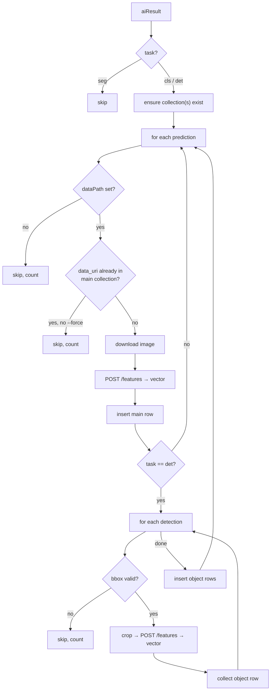

# Feature Extractor — Documentation

Reads **inspection documents** from MongoDB, downloads the image behind every
prediction from **object storage**, sends it to the **feature extraction API**, and
stores the returned feature vector together with the inspection metadata in
**Milvus**, one collection per process and model.

It lives beside `inspection_summarizer` and shares nothing with it except the source
collection. Every module it needs is its own copy, so either tool can change without
affecting the other.

---

## 1. What was implemented

```
inspection-summarizer/
├── extract.py                         entry point:  python extract.py ...
└── feature_extractor/
    ├── config.py                      ← all connection constants and tunables (the only file you edit)
    ├── cli.py                         verify / run commands and all their flags
    ├── pipeline.py                    day loop, document parsing, fan-out over aiResults
    ├── extractor.py                   the per-aiResult step: cls / det / seg rules
    ├── object_storage.py              S3 client: download the bytes behind dataPath
    ├── feature_api.py                 HTTP client for POST /features
    ├── imaging.py                     image size, bbox validation, cropping
    ├── milvus_store.py                collection naming, schema, dedup query, insert
    ├── report.py                      run counters and their rendering
    ├── repositories.py                read-only access to the inspection collection
    ├── db.py                          MongoDB connection wrapper
    ├── filters.py                     InspectionFilter → MongoDB query (+ per-aiResult re-check)
    ├── requirements.txt               pydantic, pymongo, boto3, pymilvus, Pillow, requests
    ├── common/
    │   ├── constants.py               ModelTasks, InspectionMode, UploadStatus
    │   └── datetime_util.py           day truncation, day-window iteration
    └── schemas/
        ├── base.py                    DataModel: snake_case ↔ camelCase storage
        └── inspections.py             InspectionDocumentV1 and its tree
```

| Module | Responsibility |
|---|---|
| `config.py` | MongoDB source, object storage, feature API, Milvus, and the layout constants (`FEATURE_DIM`, metric, index type, collection prefix/suffix, VARCHAR length, crop format). |
| `cli.py` | `verify` (connectivity plus one real image through the whole chain) and `run` (the job). Prints the resolved query, the matched count, and asks for confirmation before writing. |
| `pipeline.py` | Walks the window one UTC day at a time, parses each document, applies the per-aiResult filters, and hands every surviving aiResult to the extractor. One broken aiResult is logged and counted, never fatal. |
| `extractor.py` | The business rules: skip `seg`, one row per prediction for `cls` and `det`, one extra row per valid detection for `det`. Handles download, API call, and insert per row, counting every failure. |
| `object_storage.py` | Synchronous boto3 S3 client with the same endpoint, bucket, credentials, and v4 signature as the reference aiobotocore client. |
| `feature_api.py` | Posts the image as multipart with `include_feature_map=false`, reads `feature_vector.data`, and checks its length against `FEATURE_DIM`. Guesses the content type from the filename. |
| `imaging.py` | `normalize_bbox` turns a stored bbox into integer pixel bounds inside the image or `None`; `crop` re-encodes the region for the API. |
| `milvus_store.py` | Builds and sanitizes collection names, creates collections with the schema and vector index, loads them, answers "does this `data_uri` already exist", and inserts rows. |
| `report.py` | `RunReport`: one counter per skip and failure reason, rendered at the end of a run and optionally written as JSON. |
| `filters.py`, `repositories.py`, `db.py`, `common/`, `schemas/` | Copies of the summarizer's equivalents with imports renamed. `filters.py` is identical in behaviour, so the same flags select the same documents in both tools. |

### Deviation from the reference inspection schema

One, deliberate. In `schemas/inspections.py` the detection `bbox` is
`list[float] | None` instead of a required list of non-negative floats. With the
reference typing, a single null bbox makes pydantic reject the **whole inspection
document**, and the requirement here is to skip that one detection and keep going.
Validation of the box itself happens in `imaging.normalize_bbox`.

---

## 2. What one aiResult becomes



### Collections

```
VFM_{process}_{modelName}_{modelVersion}            cls and det: one row per prediction
VFM_{process}_{modelName}_{modelVersion}_object     det only: one row per valid detection
```

`process` is `metadata.process`; `modelName` and `modelVersion` come from splitting
`aiModel` on its last slash. Milvus allows only letters, digits, and underscores in a
collection name, so any other character is replaced by `_` and a warning is logged
once per name.

A collection is created the first time it is needed, with the schema below and a
vector index of type `MILVUS_INDEX_TYPE` (`AUTOINDEX`) and metric
`MILVUS_METRIC_TYPE` (`COSINE`). A collection that already exists is used as is;
changing the constants later does not alter it.

### Schema (both collections)

| Field | Type | Value |
|---|---|---|
| `pk` | INT64, auto id | Milvus-generated primary key |
| `filename` | VARCHAR | Part of `dataPath` after the last slash |
| `data_uri` | VARCHAR | `prediction.dataPath` exactly as stored; the S3 object key |
| `feature_vector` | FLOAT_VECTOR, dim `FEATURE_DIM` (2048) | `feature_vector.data` from the API |
| `prediction` | VARCHAR, nullable | see per-task rules below |
| `confidence` | FLOAT | see per-task rules below |
| `elapsed_time` | FLOAT | `prediction.elapsedTime` |
| `gbm` | VARCHAR | `metadata.gbm` |
| `process` | VARCHAR | `metadata.process` |
| `location` | VARCHAR | `metadata.location` |
| `equipment_id` | VARCHAR | `metadata.equipmentId` |
| `product_id` | VARCHAR, nullable | `metadata.productId` |
| `created_at` | VARCHAR | `metadata.createdAt` as an ISO string, e.g. `2026-06-20T08:00:00` |
| `task` | VARCHAR | `aiResult.task`: `cls` or `det` |
| `bbox` | ARRAY<FLOAT>, capacity 4 | **object collection only**: the four stored coordinates of the detection |

Every VARCHAR uses `VARCHAR_MAX_LENGTH` (512). Nullable fields require Milvus 2.5 or
newer.

### Per-task rules

**Confidence stored as a list.** Wherever a `confidence` is a list of floats, its
**maximum** is used. A plain float is used as is.

**cls, main row.** `prediction` and `confidence` come straight from the prediction
element.

**det, main row.** The image is sent to the API whole.

- `prediction` = the detections' labels joined with `_`, in stored order, e.g.
  `NG_Scratch_Good`. With zero detections it is `None`.
- `confidence` = mean of the detections' confidences, e.g. `(0.9 + 0.95 + 0.7) / 3`.
  With zero detections it is `0.0`.

**det, object rows.** One per detection whose bbox is valid. The image is cropped to
the bbox and the crop is sent to the API.

- `prediction` and `confidence` come from that detection.
- `filename`, `data_uri`, `elapsed_time`, and every metadata field come from the
  prediction the detection belongs to.
- `bbox` holds the stored coordinates so the row can be traced back to its region.

**bbox interpretation.** The four numbers are read as pixels `[x1, y1, x2, y2]`. When
all four lie in `[0, 1]` they are treated as fractions of the image size. A box is
skipped and counted under `bad bbox` when it is null, does not have exactly four
finite numbers, or has no area after clamping to the image edges. `verify` prints a
real bbox next to the image size so you can see which case your data is.

**Crops** are re-encoded as `CROP_IMAGE_FORMAT` (PNG, lossless) and sent with a
filename like `AA_2_data_bbox0.png`.

---

## 3. Workflow

The run walks the window one UTC day at a time, exactly like the summarizer, with
the same MongoDB query for the same flags. Within a day, documents are read
oldest-first in batches of `--batch-size`. Nothing is buffered across inspections:
every prediction is downloaded, extracted, and inserted before the next one starts.

**Fan-out.** One inspection produces one extractor call per entry in
`inspectionResults.aiResults`. `--ai-model`, `--model-name`, and `--task` are applied
twice, once in the query to select documents and again per aiResult, so matching a
document does not also process the other models inside it.

**Re-runs.** Before anything is downloaded, the main collection is queried for the
prediction's `data_uri`. A hit skips that prediction and, for det, all its detections.
So re-running an overlapping window costs one Milvus query per prediction and inserts
nothing. `--force` disables the check and inserts again, which creates duplicate rows
on purpose.

**Failures.** A failed download, API call, or insert is logged with the `dataPath`,
counted in the report, and the run moves to the next prediction. An exception
anywhere else inside one aiResult is logged with a traceback and counted under
`aiResults errors`. A failed prediction has no row, so the next run retries it.

**Throughput.** Everything is sequential: one download and one API call per
prediction, plus one API call per valid detection. This is intentional for the first
version. A thread pool can be added later if it is too slow.

---

## 4. How to run

### Step 1 — Install

```bash
pip install -r feature_extractor/requirements.txt
```

Requires Python 3.11 or newer. Milvus server 2.5 or newer, pymilvus 2.6.

### Step 2 — Fill in `feature_extractor/config.py`

This is the only file you edit. Four blocks:

```python
# MongoDB -- source (inspection documents, read-only)
SOURCE_MONGO_HOST     = "10.0.0.11"          # <-- fill in
SOURCE_MONGO_PORT     = 27017
SOURCE_MONGO_USERNAME = ""                   # leave "" if no authentication
SOURCE_MONGO_PASSWORD = ""
SOURCE_MONGO_AUTH_SOURCE = "admin"
SOURCE_MONGO_REPLICA_SET = ""                # leave "" for a standalone instance
SOURCE_DB_NAME        = "cosmo"              # <-- fill in
SOURCE_COLLECTION     = "inspections"        # <-- fill in

# Object storage (S3-compatible)                already filled
OBJECT_STORAGE_ENDPOINT   = "https://gage.ap-northeast-2.samsungspc.com"
OBJECT_STORAGE_BUCKET     = "cosmo-storage-stage"
OBJECT_STORAGE_ACCESS_KEY = "..."
OBJECT_STORAGE_SECRET_KEY = "..."

# Feature extraction API -- POST http://HOST:PORT/features
EXTRACTOR_HOST = "SERVER"                    # <-- fill in
EXTRACTOR_PORT = 24500
EXTRACTOR_PATH = "/features"
EXTRACTOR_TIMEOUT_SECONDS = 120

# Milvus                                        already filled
MILVUS_HOST     = "10.240.35.180"
MILVUS_PORT     = 19530
MILVUS_USER     = ""
MILVUS_PASSWORD = ""
MILVUS_DB_NAME  = "cosmoData"
```

Layout constants in the same file, all safe to change **before** the first run:

| Constant | Default | Meaning |
|---|---|---|
| `FEATURE_DIM` | 2048 | Vector length. The API response is checked against it. |
| `MILVUS_METRIC_TYPE` | `COSINE` | Metric of the index created on new collections. |
| `MILVUS_INDEX_TYPE` | `AUTOINDEX` | Index type created on new collections. |
| `COLLECTION_PREFIX` | `VFM` | Collection name prefix. |
| `OBJECT_COLLECTION_SUFFIX` | `_object` | Suffix of the per-detection collection. |
| `VARCHAR_MAX_LENGTH` | 512 | `max_length` of every VARCHAR field. |
| `CROP_IMAGE_FORMAT` | `PNG` | Encoding of bbox crops sent to the API. |
| `READ_BATCH_SIZE` | 500 | Default cursor batch size. |

If anything required is left blank the CLI stops immediately and names the missing
constants.

> The config file is tracked in git and now holds the object storage keys. Keep that
> in mind before pushing the repository anywhere shared.

### Step 3 — Verify

```bash
python extract.py verify
```

Writes nothing to Milvus. It pings MongoDB, object storage, and Milvus, then takes
the first inspection that has a `cls` or `det` aiResult and pushes one real image
through the whole chain:

```
source cosmo.inspections: 123456 documents
milvus http://10.240.35.180:19530/cosmoData: 4 collections

Top-level field names as stored:
  _id
  metadata
  inspectionResults
  ...
Resolved aiResults path: inspectionResults.aiResults

Sample aiResult: sidedet/sidedet_250429_260113072605 (det)
  main collection   : VFM_Side_sidedet_sidedet_250429_260113072605
  object collection : VFM_Side_sidedet_sidedet_250429_260113072605_object
  dataPath          : images/2026/06/20/AA_2_data.jpg
  filename          : AA_2_data.jpg
  download          : OK, 184233 bytes, 1920x1080 px
  first bbox        : [412.0, 88.0, 530.0, 197.0] -> pixel box (412, 88, 530, 197)
  feature API       : OK, vector length 2048 (FEATURE_DIM=2048)
```

Check three things here: the aiResults path is `inspectionResults`, the pixel box
looks right for your image size, and the vector length equals `FEATURE_DIM`.

### Step 4 — Dry run

```bash
python extract.py run --start 2026-06-20 --end 2026-06-21 --gbm SEHC --process Side --dry-run
```

Reads and counts only. No downloads, no API calls, no Milvus writes, no collections
created. It prints the filters, the resolved query, the matched document count, and a
report of what would be inserted. The dry run cannot see image sizes, so it counts
every detection as a would-be object row.

### Step 5 — Real run

```bash
python extract.py run --start 2026-06-20 --end 2026-06-21 --gbm SEHC --process Side
```

Without `--yes` you get the resolved query and a confirmation prompt before anything
is written. Missing collections are created on first use.

---

## 5. Command reference

```
python extract.py [--log-level {DEBUG,INFO,WARNING,ERROR}] {verify,run} ...
```

### `verify`

No arguments. See Step 3.

### `run`

**Time window — required.** Half-open UTC range on `metadata.createdAt`. Accepts a
date (`2026-06-20`) or a full ISO timestamp (`2026-06-20T08:00:00`).

| Flag | Meaning |
|---|---|
| `--start` | Inclusive start |
| `--end` | Exclusive end |

**Metadata filters.** Optional; omitting a flag adds no constraint. Several values to
one flag become an `$in`.

| Flag | Matches |
|---|---|
| `--gbm` | `metadata.gbm` |
| `--process` | `metadata.process` |
| `--location` | `metadata.location` |
| `--equipment-id` | `metadata.equipmentId` |
| `--product-id` | `metadata.productId` |
| `--mode` | `metadata.mode` — `test`, `production`, `rework` |
| `--local-timezone` | `metadata.localTimezone` |

**Result filters.**

| Flag | Matches |
|---|---|
| `--ai-model` | Full `aiModel` string |
| `--model-name` | Model name only, the part before the last slash |
| `--task` | `cls`, `det` (`seg` is accepted but always skipped) |
| `--conclusion` | `inspectionResults.conclusion` |
| `--upload-status` | `completed`, `processing` |
| `--include-deleted` | Include documents with `isDeleted: true` (excluded by default) |

**Execution.**

| Flag | Default | Meaning |
|---|---|---|
| `--batch-size` | 500 | Cursor batch size |
| `--limit` | — | Stop after this many inspection documents |
| `--force` | off | Insert even when the collection already has a row with the same `data_uri` |
| `--dry-run` | off | Read and count only |
| `--yes` | off | Skip the confirmation prompt |
| `--report-json PATH` | — | Write the run report as JSON |

### Examples

One day, one process, one model:

```bash
python extract.py run --start 2026-06-20 --end 2026-06-21 --gbm SEHC --process Side --model-name sidebottom
```

Only detection models, production mode:

```bash
python extract.py run --start 2026-06-20 --end 2026-06-23 --gbm SEHC --task det --mode production
```

Try 20 documents with verbose logging before a big backfill:

```bash
python extract.py --log-level DEBUG run --start 2026-06-20 --end 2026-06-21 --gbm SEHC --limit 20
```

Unattended daily job, yesterday only, report to a file:

```bash
python extract.py run --start 2026-06-25 --end 2026-06-26 --gbm SEHC --yes --report-json /var/log/extractor/2026-06-25.json
```

Rebuild the rows for a window after changing the API model:

```bash
python extract.py run --start 2026-06-20 --end 2026-06-21 --gbm SEHC --force
```

Note that `--force` adds rows; it does not delete the old ones. Drop the collection
first if you want a clean rebuild.

---

## 6. Reading the run report

```
Run COMPLETED
  days processed            : 1
  inspections read          : 340
    invalid (skipped)       : 0      ← failed schema validation
    no createdAt (skipped)  : 0
    no _id (skipped)        : 0
  aiResults seen            : 680
    filtered out            : 0      ← excluded by --ai-model / --model-name / --task
    seg (skipped)           : 340    ← segmentation models are never processed
    errors                  : 0      ← unexpected exception inside one aiResult (see log)
  collections created       : 2
  predictions seen          : 1020
    no dataPath (skipped)   : 0
    already present         : 0      ← data_uri already in the main collection (normal on a re-run)
    download failed         : 1      ← object storage error, see log for the key
    API failed              : 0      ← feature API error on the whole image
  main rows inserted        : 1019
    insert failed           : 0
  detections seen           : 2450
    bad bbox (skipped)      : 12     ← null, malformed, or zero-area bbox
    API failed              : 0      ← feature API error on a crop
  object rows inserted      : 2438
    insert failed           : 0
```

On a re-run of the same window, expect `already present` to equal the number of
predictions that succeeded before, and both `inserted` lines to be 0. In a dry run
the two `inserted` lines read `would insert`.

---

## 7. Operational notes

**Dedup is by `data_uri` in the main collection only.** If a det prediction's main
row was inserted but a later object insert failed, the next run sees the main row and
skips the whole prediction, so those object rows stay missing. Use `--force` on that
window to fill them, accepting a duplicate main row, or drop and rebuild.

**Existing collections are never altered.** Changing `FEATURE_DIM`, the metric, the
index type, or `VARCHAR_MAX_LENGTH` affects only collections created afterwards. A
`FEATURE_DIM` that no longer matches an existing collection makes inserts fail.

**A dry run over-counts object rows.** It cannot validate bboxes without downloading
the image, so it assumes every detection is valid.

**One image can appear in several inspections.** Each inspection is processed on its
own, so the dedup query also catches a `data_uri` inserted earlier in the same run.
Milvus reads are bounded-consistent, so a row inserted a moment earlier might not be
visible yet; in that rare case the image is inserted twice.

**Content types.** The API accepts jpeg, png, bmp, webp, and tiff. The type is guessed
from the filename extension; anything else is sent as `image/jpeg` and left for the
API to accept or reject.

**Do not run two overlapping jobs at once.** There is no lock, and the dedup check is
not atomic with the insert.

**Timezone.** Days follow UTC, matching the summarizer. `created_at` is stored exactly
as `metadata.createdAt` is stored, without conversion.

---

## 8. Verification performed

No live MongoDB, object storage, API, or Milvus connection was made during
development; `verify` is the first thing to run once `config.py` is filled in.

Exercised offline against fake backends with real pydantic parsing and real Pillow
cropping:

- Three aiResults (cls, det, seg): seg skipped, three collections created in order,
  main and object collections named as specified.
- cls row carrying the expected filename, prediction, max-of-list confidence,
  elapsed time, all metadata fields, ISO `created_at`, and a vector of the expected
  length.
- det main row with `NG_Scratch_Good_Good_Good` and the mean confidence; a det
  prediction with zero detections inserted with `None` / `0.0`.
- Detections: a pixel bbox, a normalized bbox, and a bbox spilling past the image edge
  cropped to 40×30, 40×32, and 10×10 respectively; a zero-width and a null bbox
  skipped and counted.
- A missing object and an API failure each counted once, with the run continuing.
- A re-run skipping every previously inserted prediction with no download or API call,
  retrying only the two that failed; `--force` re-inserting everything.
- A dry run making no downloads, API calls, collections, or inserts.
- The Milvus schema (nullable VARCHARs, FLOAT array, 2048-dim vector) and the
  AUTOINDEX/COSINE index parameters accepted by pymilvus 2.6.12.
