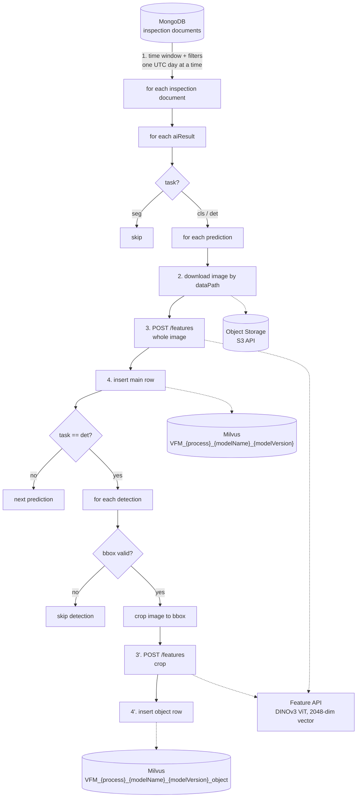
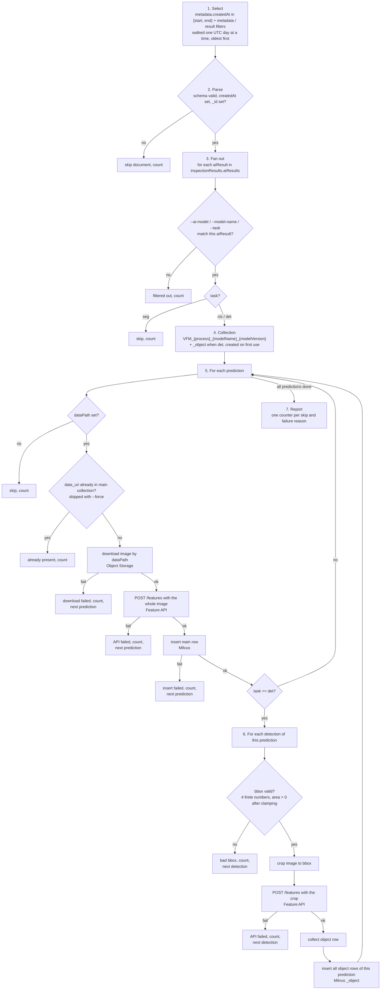

# [Data Service] Feature Vector Extraction Pipeline — How It Works

**Korean version:** [pipeline.ko.md](pipeline.ko.md)

---

## 1. Purpose

- Populate the Data Feature Hub (Milvus) with a feature vector for every image judged by a deployed inspection model.
  - Enables similarity search, coreset sampling, and labeling validation on real production data.
- Feature vectors cannot be extracted on the edge and shipped together with the data.
  - Extraction therefore runs as a batch pipeline on the Suwon server.
  - It reads the inspection records already collected there.
- The pipeline is a sibling of the Inspection Summarizer.
  - Same inspection collection, same selection filters.
  - Same way of running: explicit time window, dry run, confirmation prompt, run report.
  - The summarizer folds inspections into daily statistics; this pipeline turns each inspected image into one Milvus row.

---

## 2. Overall architecture

### 2.1 Diagram



### 2.2 Components

| Component | Role | Access |
|---|---|---|
| MongoDB (inspection collection) | Source of truth for what was inspected, by which model, with which result, and where the image is | Read-only |
| Object Storage | Holds the inspected images, keyed by `prediction.dataPath` | Read-only |
| Feature extraction API | `POST /features` returns a 2048-dimensional feature vector for one image (DINOv3 ViT) | HTTP |
| Milvus | One collection per (process, model name, model version) holding vector + inspection metadata rows | Read (dedup) + write |
| Pipeline | Selects documents, applies the per-task rules, drives the three calls per image, counts every skip and failure | Batch, manual or scheduled |

---

## 3. Input: the inspection document

- Only the parts shown below are used.

```
{
  "_id": ...,
  "metadata": {
    "gbm": "SEHC", "process": "Side", "location": "Line_01",
    "equipmentId": "SEHC_Side_VM07", "productId": "...",
    "createdAt": ISODate("2026-06-20T08:12:31Z"), "mode": "production"
  },
  "inspectionResults": {
    "aiResults": [
      {
        "aiModel": "sidebottom/sidebottom_250429_260113072605",   // modelName/modelVersion
        "task": "cls",                                            // cls | det | seg
        "predictions": [
          { "dataPath": "images/2026/06/20/AA_2_data.jpg",        // object key in storage
            "prediction": "Good", "confidence": [0.03, 0.97],     // float or list of floats
            "elapsedTime": 0.42 }
        ]
      },
      {
        "aiModel": "sidedet/sidedet_v3",
        "task": "det",
        "predictions": [
          { "dataPath": "images/2026/06/20/AA_2_data.jpg", "elapsedTime": 0.61,
            "detections": [
              { "prediction": "NG",      "confidence": 0.90, "bbox": [412, 88, 530, 197] },
              { "prediction": "Scratch", "confidence": 0.95, "bbox": [601, 240, 655, 302] },
              { "prediction": "Good",    "confidence": 0.70, "bbox": [ 12, 15,  80,  64] }
            ] }
        ]
      }
    ]
  },
  "isDeleted": false
}
```

| Element | Meaning |
|---|---|
| `metadata.*` | Where and when the inspection happened; copied onto every Milvus row |
| `aiResults[]` | One entry per model that ran on this inspection |
| `aiModel` | `modelName/modelVersion`, split on the last slash |
| `task` | `cls`, `det`, or `seg`; decides the rules in §5 |
| `predictions[]` | One entry per inspected image or patch |
| `dataPath` | Object key of the image; becomes `data_uri`, and its last segment becomes `filename` |
| `prediction`, `confidence` | The model's label and score; `confidence` is a float or a list of floats |
| `detections[]` (det only) | One entry per detected object with its own `prediction`, `confidence`, and `bbox` |

---

## 4. Output: Milvus collections

### 4.1 Naming

```
VFM_{process}_{modelName}_{modelVersion}            cls and det: one row per prediction (whole image)
VFM_{process}_{modelName}_{modelVersion}_object     det only:    one row per detection (image cropped to its bbox)

example:  process=Side, aiModel=sidedet/sidedet_v3
          ->  VFM_Side_sidedet_sidedet_v3  and  VFM_Side_sidedet_sidedet_v3_object
```

- `process` is `metadata.process`; `modelName` and `modelVersion` come from `aiModel`.
- Characters other than letters, digits, and underscores are replaced by `_`.
- A classification model has one collection; a detection model has two.
- A collection is created on first use.
  - Vector index `AUTOINDEX` with metric `COSINE`, vector dimension 2048.
  - An existing collection is reused as is.

### 4.2 Record schema

| # | Field | Type | Source |
|---|---|---|---|
| 1 | `pk` | INT64, auto | Primary key generated by Milvus |
| 2 | `filename` | VARCHAR | Last segment of `dataPath`, e.g. `AA_2_data.jpg` |
| 3 | `data_uri` | VARCHAR | `dataPath` as stored, the unique object key of the image |
| 4 | `feature_vector` | FLOAT_VECTOR (2048) | `feature_vector.data` from the feature API |
| 5 | `prediction` | VARCHAR, nullable | Model's label, per-task rule in §5 |
| 6 | `confidence` | FLOAT | Confidence of the prediction, per-task rule in §5 |
| 7 | `elapsed_time` | FLOAT | `prediction.elapsedTime`, inspection duration for that image |
| 8 | `gbm` | VARCHAR | `metadata.gbm`, manufacturing site |
| 9 | `process` | VARCHAR | `metadata.process`, process line |
| 10 | `location` | VARCHAR | `metadata.location`, location of the line within the site |
| 11 | `equipment_id` | VARCHAR | `metadata.equipmentId` |
| 12 | `product_id` | VARCHAR, nullable | `metadata.productId` |
| 13 | `created_at` | VARCHAR | `metadata.createdAt` as an ISO string, e.g. `2026-06-20T08:12:31` |
| 14 | `task` | VARCHAR | `aiResult.task`, `cls` or `det` |
| 15 | `bbox` | ARRAY<FLOAT>(4) | `_object` collection only: the detection's stored `[x1, y1, x2, y2]` |

---

## 5. Processing flow

### 5.1 End to end



### 5.2 Selection (step 1)

- Identical to the Inspection Summarizer.

| Filter | Field | Note |
|---|---|---|
| time window (required) | `metadata.createdAt` | half-open `[start, end)`, UTC |
| gbm, process, location, equipment id, product id, mode, local timezone | `metadata.*` | several values become `$in` |
| ai model, model name, task | `inspectionResults.aiResults.*` | applied in the query and again per aiResult |
| conclusion, upload status | `inspectionResults.conclusion`, `uploadStatus` | |
| deleted | `isDeleted` | excluded unless `--include-deleted` |

- The window is walked one UTC day at a time.
  - A long backfill becomes a sequence of self-contained, retryable days.
- The model filters are re-checked per aiResult.
  - Matching a document must not process the other models inside it.

### 5.3 Task routing (step 3)

| `task` | Handling |
|---|---|
| `seg` | Skipped, produces no rows |
| `cls` | One row per prediction in the main collection |
| `det` | One row per prediction in the main collection, plus one row per valid detection in the `_object` collection |

### 5.4 Common rules for every row

- A `confidence` stored as a list of floats is reduced to its maximum.
  - A plain float is used as is.
- `data_uri` is `dataPath` unchanged.
  - `filename` is the part after its last slash.
- `created_at` is `metadata.createdAt` written as an ISO string.
  - No timezone conversion is applied.
- `gbm`, `process`, `location`, `equipment_id`, and `product_id` are copied from the inspection document.

### 5.5 Classification (`cls`)

- One row per prediction, with the whole image sent to the feature API.

| Field | Value |
|---|---|
| `prediction` | `prediction.prediction` |
| `confidence` | `prediction.confidence`, max if list |

### 5.6 Detection (`det`)

**Main row**

- One row per prediction, with the whole image sent to the feature API.

| Field | Value |
|---|---|
| `prediction` | The detections' labels joined with `_` in stored order; `None` when there are no detections |
| `confidence` | Mean of the detections' confidences, each reduced to its max if a list; `0.0` when there are no detections |

**Object rows**

- One row per detection with a valid bbox, in the `_object` collection.
  - The image is cropped to the bbox and the crop is sent to the feature API.

| Field | Value |
|---|---|
| `prediction`, `confidence` | The detection's own label and confidence |
| `bbox` | The detection's stored coordinates |
| `filename`, `data_uri`, `elapsed_time`, metadata | From the prediction the detection belongs to |

**bbox validation**

- `[x1, y1, x2, y2]` is read as pixel coordinates.
  - When all four values lie in `[0, 1]`, they are treated as fractions of the image size.
  - A box extending past the image edge is clamped to the edge.
- A detection is skipped and counted when its bbox is invalid.
  - Invalid means null, not exactly four finite numbers, or no area after clamping.
  - Skipped detections still take part in the main row's `prediction` and `confidence`.

### 5.7 Worked example

- One det prediction of `AA_2_data.jpg` with three detections:

| detection | prediction | confidence | bbox |
|---|---|---|---|
| 0 | NG | 0.90 | [412, 88, 530, 197] |
| 1 | Scratch | 0.95 | [601, 240, 655, 302] |
| 2 | Good | 0.70 | null |

- Result: 3 API calls and 3 rows.

| collection | filename | data_uri | prediction | confidence | bbox | image sent |
|---|---|---|---|---|---|---|
| `VFM_Side_sidedet_sidedet_v3` | AA_2_data.jpg | images/2026/06/20/AA_2_data.jpg | `NG_Scratch_Good` | (0.90+0.95+0.70)/3 = **0.85** | — | whole image |
| `VFM_Side_sidedet_sidedet_v3_object` | AA_2_data.jpg | images/2026/06/20/AA_2_data.jpg | `NG` | 0.90 | [412, 88, 530, 197] | 118×109 crop |
| `VFM_Side_sidedet_sidedet_v3_object` | AA_2_data.jpg | images/2026/06/20/AA_2_data.jpg | `Scratch` | 0.95 | [601, 240, 655, 302] | 54×62 crop |

- Detection 2 has no bbox, so it gets no object row.
  - Its label and confidence still count in the main row.
- Every row also carries `elapsed_time = 0.61`, the metadata fields, `created_at`, and `task = det`.
- The `cls` result from §3 on the same inspection adds one more row.
  - Collection `VFM_Side_sidebottom_sidebottom_250429_260113072605`.
  - `prediction = Good`, `confidence = 0.97` (max of the list), vector of the whole image.

---

## 6. Feature API call

```
POST http://{host}:{port}/features?include_feature_map=false
Content-Type: multipart/form-data;  file=<image bytes>
```

- Feature maps are never requested.
  - Only `feature_vector.data` from the response is used.
- The vector length is checked against the configured dimension (2048).
  - A mismatch counts as an API failure for that image.
- Content type is taken from the filename extension.
  - Supported: jpeg, png, bmp, webp, tiff.
- Crops are sent as PNG.
  - Named after the source image and detection index, e.g. `AA_2_data_bbox0.png`.
- Calls are sequential: one per prediction, plus one per valid detection.

---

## 7. Re-runs and failure handling

**Idempotency**

- Before anything is downloaded, the main collection is queried for the prediction's `data_uri`.
  - A hit skips that prediction and, for det, all its detections.
- Re-running an overlapping window therefore inserts nothing.
  - It costs one Milvus query per prediction.
- `--force` disables the check and inserts again.
  - This creates duplicate rows on purpose.

**Failures**

- Failures are per image, never per run.

| Failure | Effect |
|---|---|
| Document fails validation, has no `createdAt`, or has no `_id` | Document skipped, counted |
| Prediction without `dataPath` | Prediction skipped, counted |
| Object storage download fails | Prediction skipped, counted; retried on the next run since no row exists |
| Feature API fails on the whole image | Prediction skipped, counted; retried on the next run |
| Milvus insert fails | Counted; retried on the next run |
| Invalid bbox | Detection skipped, counted; main row still written |
| Feature API fails on a crop | That detection skipped, counted; other detections and the main row unaffected |
| Any other exception inside one aiResult | Logged with traceback, counted, next aiResult |

**Run report**

- Every counter above has its own line.
  - The operator sees at a glance why rows are missing.

```
Run COMPLETED
  days processed            : 1
  inspections read          : 340
    invalid (skipped)       : 0
  aiResults seen            : 680
    filtered out            : 0
    seg (skipped)           : 340
    errors                  : 0
  collections created       : 2
  predictions seen          : 1020
    no dataPath (skipped)   : 0
    already present         : 0        ← normal on a re-run
    download failed         : 1
    API failed              : 0
  main rows inserted        : 1019
    insert failed           : 0
  detections seen           : 2450
    bad bbox (skipped)      : 12
    API failed              : 0
  object rows inserted      : 2438
    insert failed           : 0
```

---

## 8. How to run

- The pipeline is a command-line batch job.
  - Same three-step habit as the summarizer: verify, dry run, run.

**Verify** — `python extract.py verify`

- Pings MongoDB, object storage, and Milvus.
- Takes one real inspection and downloads its image.
- Prints the image size and a real bbox next to its resolved pixel box.
- Calls the feature API once and prints the vector length.
- Writes nothing.

**Dry run** — `python extract.py run --start 2026-06-20 --end 2026-06-21 --gbm SEHC --process Side --dry-run`

- Reads and counts only.
  - No downloads, no API calls, no Milvus writes.
- Prints the resolved query, the matched count, and the would-insert report.

**Run** — `python extract.py run --start 2026-06-20 --end 2026-06-21 --gbm SEHC --process Side`

- Asks for confirmation, then processes.
  - `--yes` skips the prompt for scheduled jobs.

**Flags**

| Flag | Meaning |
|---|---|
| `--start`, `--end` | Required UTC window on `metadata.createdAt`, half-open |
| `--gbm`, `--process`, `--location`, `--equipment-id`, `--product-id`, `--mode`, `--local-timezone` | Metadata filters, repeat a value for OR |
| `--ai-model`, `--model-name`, `--task`, `--conclusion`, `--upload-status`, `--include-deleted` | Result filters |
| `--limit N` | Stop after N inspection documents |
| `--force` | Insert even when the `data_uri` already exists |
| `--dry-run`, `--yes`, `--report-json PATH`, `--log-level` | Execution control |

**Typical usages**

```bash
# first trial: 20 documents, verbose
python extract.py --log-level DEBUG run --start 2026-06-20 --end 2026-06-21 --gbm SEHC --limit 20

# one model only
python extract.py run --start 2026-06-20 --end 2026-06-21 --gbm SEHC --process Side --model-name sidebottom

# detection models only, production mode, three days
python extract.py run --start 2026-06-20 --end 2026-06-23 --gbm SEHC --task det --mode production

# unattended daily job
python extract.py run --start 2026-06-25 --end 2026-06-26 --gbm SEHC --yes --report-json /var/log/extractor/2026-06-25.json
```

- All configuration lives in a single constants file.
  - MongoDB source, object storage, feature API host and port, Milvus, vector dimension, index metric, collection prefix.

---

## 9. Constraints and notes

- **Throughput** — everything is sequential.
  - One download and one API call per prediction, plus one API call per valid detection.
  - Fine for daily increments; a large backfill takes correspondingly long.
- **Dedup scope** — only the main collection is checked.
  - If a det prediction's main row was written but its object rows failed, the next run skips the whole prediction.
  - Use `--force` on that window, or drop and rebuild the collection.
- **Existing collections** — never altered.
  - Changing the vector dimension, metric, or index type applies only to collections created afterwards.
- **Dry run** — cannot see image sizes.
  - Every detection is counted as a would-be object row.
- **Milvus version** — nullable fields need Milvus 2.5 or newer.
- **Concurrency** — do not run two overlapping windows at once.
  - The dedup check is not atomic with the insert.
- **Timezone** — days follow UTC, matching the summarizer.
  - `created_at` is stored exactly as `metadata.createdAt` is stored.
- **Segmentation** — never processed.
- **bbox semantics** — pixels are assumed.
  - Values all within `[0, 1]` are treated as normalized.
  - Confirm with `verify` on real data.
