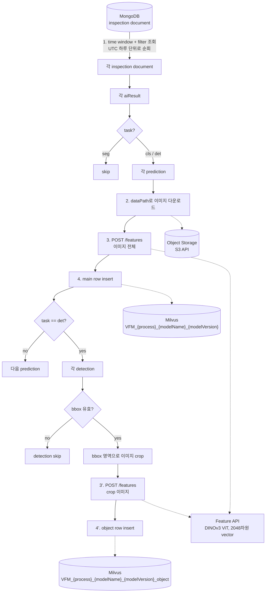
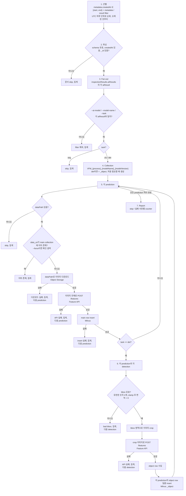

# [데이터 서비스] Feature Vector 추출 파이프라인 — 동작 원리

**English version:** [pipeline.en.md](pipeline.en.md)

---

## 1. 목적

- 배포된 검사 모델이 판정한 모든 이미지의 feature vector를 데이터 Feature Hub(Milvus)에 적재한다.
  - 실제 양산 데이터 기반의 유사도 검색, coreset sampling, labeling validation이 가능해진다.
- Edge에서 feature vector를 추출하여 데이터와 함께 전송하는 것은 어려운 상태이다.
  - 따라서 수원 서버에서 배치 파이프라인으로 추출한다.
  - 이미 수집된 검사 기록을 읽어서 처리한다.
- Inspection Summarizer와 동일한 계열의 작업이다.
  - 같은 inspection collection, 같은 조회 조건.
  - 같은 실행 방식: 명시적 time window, dry run, 확인 프롬프트, run report.
  - Summarizer는 검사 결과를 일별 통계로 접고, 이 파이프라인은 검사된 이미지 하나를 Milvus row 하나로 만든다.

---

## 2. 전체 구조

### 2.1 구조도



### 2.2 컴포넌트별 역할

| 컴포넌트 | 역할 | 접근 |
|---|---|---|
| MongoDB (inspection collection) | 무엇을, 어떤 모델이, 어떤 결과로 검사했고 이미지가 어디 있는지의 원본 | 읽기 전용 |
| Object Storage | 검사 이미지 보관, `prediction.dataPath`가 object key | 읽기 전용 |
| Feature 추출 API | `POST /features`로 이미지 1장의 2048차원 feature vector 반환 (DINOv3 ViT) | HTTP |
| Milvus | (process, modelName, modelVersion)당 collection 하나에 vector + 검사 metadata row 저장 | 읽기(중복 확인) + 쓰기 |
| Pipeline | 문서 선별, task별 규칙 적용, 이미지당 3개 호출 수행, 모든 skip / 실패 집계 | 배치, 수동 또는 스케줄 |

---

## 3. 입력: Inspection Document

- 아래에 표시된 부분만 사용한다.

```
{
  "_id": ...,
  "metadata": {
    "gbm": "SEHC", "process": "Side", "location": "Line_01",
    "equipmentId": "SEHC_Side_VM07", "productId": "...",
    "createdAt": ISODate("2026-06-20T08:12:31Z"), "mode": "production"
  },
  "inspectionResults": {
    "aiResults": [
      {
        "aiModel": "sidebottom/sidebottom_250429_260113072605",   // modelName/modelVersion
        "task": "cls",                                            // cls | det | seg
        "predictions": [
          { "dataPath": "images/2026/06/20/AA_2_data.jpg",        // object storage의 key
            "prediction": "Good", "confidence": [0.03, 0.97],     // float 또는 float list
            "elapsedTime": 0.42 }
        ]
      },
      {
        "aiModel": "sidedet/sidedet_v3",
        "task": "det",
        "predictions": [
          { "dataPath": "images/2026/06/20/AA_2_data.jpg", "elapsedTime": 0.61,
            "detections": [
              { "prediction": "NG",      "confidence": 0.90, "bbox": [412, 88, 530, 197] },
              { "prediction": "Scratch", "confidence": 0.95, "bbox": [601, 240, 655, 302] },
              { "prediction": "Good",    "confidence": 0.70, "bbox": [ 12, 15,  80,  64] }
            ] }
        ]
      }
    ]
  },
  "isDeleted": false
}
```

| 항목 | 의미 |
|---|---|
| `metadata.*` | 검사가 이루어진 장소와 시각, 모든 Milvus row에 복사됨 |
| `aiResults[]` | 이 검사에서 실행된 모델당 하나 |
| `aiModel` | `modelName/modelVersion`, 마지막 슬래시 기준으로 분리 |
| `task` | `cls`, `det`, `seg`, §5의 규칙을 결정 |
| `predictions[]` | 검사된 이미지 또는 patch당 하나 |
| `dataPath` | 이미지의 object key, `data_uri`가 되고 마지막 segment는 `filename`이 됨 |
| `prediction`, `confidence` | 모델의 라벨과 점수, `confidence`는 float 또는 float list |
| `detections[]` (det만) | 검출된 객체당 하나, 각각 `prediction`, `confidence`, `bbox`를 가짐 |

---

## 4. 출력: Milvus Collection

### 4.1 명명 규칙

```
VFM_{process}_{modelName}_{modelVersion}            cls·det: prediction당 row 1개 (이미지 전체)
VFM_{process}_{modelName}_{modelVersion}_object     det만:   detection당 row 1개 (bbox로 crop한 이미지)

예시:  process=Side, aiModel=sidedet/sidedet_v3
       ->  VFM_Side_sidedet_sidedet_v3  및  VFM_Side_sidedet_sidedet_v3_object
```

- `process`는 `metadata.process`, `modelName`과 `modelVersion`은 `aiModel`에서 가져온다.
- 영문자, 숫자, 밑줄 이외의 문자는 `_`로 치환된다.
- Classification 모델은 collection 1개, detection 모델은 2개를 가진다.
- Collection은 처음 필요할 때 생성된다.
  - Vector index `AUTOINDEX`, metric `COSINE`, vector 차원 2048.
  - 이미 존재하는 collection은 그대로 사용한다.

### 4.2 Record Schema

| # | 필드 | 타입 | 출처 |
|---|---|---|---|
| 1 | `pk` | INT64, auto | Milvus가 생성하는 primary key |
| 2 | `filename` | VARCHAR | `dataPath`의 마지막 segment, 예: `AA_2_data.jpg` |
| 3 | `data_uri` | VARCHAR | `dataPath` 그대로, 이미지의 고유한 object key |
| 4 | `feature_vector` | FLOAT_VECTOR (2048) | Feature API 응답의 `feature_vector.data` |
| 5 | `prediction` | VARCHAR, nullable | 모델의 라벨, §5의 task별 규칙 |
| 6 | `confidence` | FLOAT | 예측 confidence, §5의 task별 규칙 |
| 7 | `elapsed_time` | FLOAT | `prediction.elapsedTime`, 해당 이미지의 검사 소요 시간 |
| 8 | `gbm` | VARCHAR | `metadata.gbm`, 법인 |
| 9 | `process` | VARCHAR | `metadata.process`, 공정 라인 |
| 10 | `location` | VARCHAR | `metadata.location`, 법인 내 공정 라인의 위치 |
| 11 | `equipment_id` | VARCHAR | `metadata.equipmentId` |
| 12 | `product_id` | VARCHAR, nullable | `metadata.productId` |
| 13 | `created_at` | VARCHAR | `metadata.createdAt`의 ISO 문자열, 예: `2026-06-20T08:12:31` |
| 14 | `task` | VARCHAR | `aiResult.task`, `cls` 또는 `det` |
| 15 | `bbox` | ARRAY<FLOAT>(4) | `_object` collection 전용, detection의 원본 `[x1, y1, x2, y2]` |

---

## 5. 처리 흐름

### 5.1 전체 흐름



### 5.2 선별 (1단계)

- Inspection Summarizer와 동일하다.

| Filter | 필드 | 비고 |
|---|---|---|
| time window (필수) | `metadata.createdAt` | 반개구간 `[start, end)`, UTC |
| gbm, process, location, equipment id, product id, mode, local timezone | `metadata.*` | 여러 값은 `$in`이 됨 |
| ai model, model name, task | `inspectionResults.aiResults.*` | 조회 시와 aiResult 단위로 다시 적용 |
| conclusion, upload status | `inspectionResults.conclusion`, `uploadStatus` | |
| deleted | `isDeleted` | `--include-deleted`가 없으면 제외 |

- Window는 UTC 하루 단위로 순회한다.
  - 긴 backfill이 독립적으로 재시도 가능한 하루 작업의 연속이 된다.
- 모델 filter는 aiResult 단위로 다시 확인한다.
  - 문서가 매칭되었다고 그 안의 다른 모델까지 처리하면 안 된다.

### 5.3 Task별 분기 (3단계)

| `task` | 처리 |
|---|---|
| `seg` | Skip, row를 만들지 않음 |
| `cls` | Main collection에 prediction당 row 1개 |
| `det` | Main collection에 prediction당 row 1개, 추가로 `_object` collection에 유효한 detection당 row 1개 |

### 5.4 모든 row에 공통인 규칙

- Float list로 저장된 `confidence`는 최댓값으로 줄인다.
  - 단일 float은 그대로 사용한다.
- `data_uri`는 `dataPath` 그대로이다.
  - `filename`은 마지막 슬래시 뒤 부분이다.
- `created_at`은 `metadata.createdAt`을 ISO 문자열로 기록한 것이다.
  - Timezone 변환은 하지 않는다.
- `gbm`, `process`, `location`, `equipment_id`, `product_id`는 inspection document에서 복사한다.

### 5.5 Classification (`cls`)

- Prediction당 row 1개, 이미지 전체를 feature API에 전송한다.

| 필드 | 값 |
|---|---|
| `prediction` | `prediction.prediction` |
| `confidence` | `prediction.confidence`, list이면 최댓값 |

### 5.6 Detection (`det`)

**Main row**

- Prediction당 row 1개, 이미지 전체를 feature API에 전송한다.

| 필드 | 값 |
|---|---|
| `prediction` | Detection들의 라벨을 저장 순서대로 `_`로 연결, detection이 없으면 `None` |
| `confidence` | Detection들의 confidence 평균 (각각 list이면 먼저 최댓값), detection이 없으면 `0.0` |

**Object row**

- bbox가 유효한 detection당 row 1개, `_object` collection에 저장한다.
  - 이미지를 bbox 영역으로 crop하여 feature API에 전송한다.

| 필드 | 값 |
|---|---|
| `prediction`, `confidence` | 해당 detection 자체의 라벨과 confidence |
| `bbox` | 해당 detection의 원본 좌표 |
| `filename`, `data_uri`, `elapsed_time`, metadata | 해당 detection이 속한 prediction에서 가져옴 |

**bbox 검증**

- `[x1, y1, x2, y2]`를 pixel 좌표로 해석한다.
  - 네 값이 모두 `[0, 1]` 안에 있으면 이미지 크기에 대한 비율로 해석한다.
  - 이미지 경계를 벗어나는 box는 경계로 clamp한다.
- bbox가 유효하지 않은 detection은 skip하고 집계한다.
  - 유효하지 않음: null, 유한한 숫자 4개가 아님, clamp 후 면적 0.
  - Skip된 detection도 main row의 `prediction`과 `confidence` 계산에는 포함된다.

### 5.7 예시

- `AA_2_data.jpg`에 대한 det prediction 하나, detection 3개:

| detection | prediction | confidence | bbox |
|---|---|---|---|
| 0 | NG | 0.90 | [412, 88, 530, 197] |
| 1 | Scratch | 0.95 | [601, 240, 655, 302] |
| 2 | Good | 0.70 | null |

- 결과: API 호출 3회, row 3개.

| collection | filename | data_uri | prediction | confidence | bbox | 전송 이미지 |
|---|---|---|---|---|---|---|
| `VFM_Side_sidedet_sidedet_v3` | AA_2_data.jpg | images/2026/06/20/AA_2_data.jpg | `NG_Scratch_Good` | (0.90+0.95+0.70)/3 = **0.85** | — | 이미지 전체 |
| `VFM_Side_sidedet_sidedet_v3_object` | AA_2_data.jpg | images/2026/06/20/AA_2_data.jpg | `NG` | 0.90 | [412, 88, 530, 197] | 118×109 crop |
| `VFM_Side_sidedet_sidedet_v3_object` | AA_2_data.jpg | images/2026/06/20/AA_2_data.jpg | `Scratch` | 0.95 | [601, 240, 655, 302] | 54×62 crop |

- Detection 2는 bbox가 없어 object row가 없다.
  - 라벨과 confidence는 main row에 반영된다.
- 모든 row는 `elapsed_time = 0.61`, metadata 필드, `created_at`, `task = det`도 함께 가진다.
- 같은 검사의 §3 `cls` 결과는 row 1개를 추가한다.
  - Collection `VFM_Side_sidebottom_sidebottom_250429_260113072605`.
  - `prediction = Good`, `confidence = 0.97` (list의 최댓값), 이미지 전체의 vector.

---

## 6. Feature API 호출

```
POST http://{host}:{port}/features?include_feature_map=false
Content-Type: multipart/form-data;  file=<image bytes>
```

- Feature map은 요청하지 않는다.
  - 응답의 `feature_vector.data`만 사용한다.
- Vector 길이를 설정된 차원(2048)과 비교한다.
  - 불일치하면 해당 이미지에 대한 API 실패로 처리한다.
- Content type은 파일 확장자로 결정한다.
  - 지원: jpeg, png, bmp, webp, tiff.
- Crop 이미지는 PNG로 전송한다.
  - 원본 이미지 이름과 detection index로 명명한다 (예: `AA_2_data_bbox0.png`).
- 호출은 순차적이다: prediction당 1회 + 유효한 detection당 1회.

---

## 7. 재실행 및 실패 처리

**멱등성**

- 다운로드 전에 main collection에서 해당 prediction의 `data_uri`를 조회한다.
  - 존재하면 그 prediction과 (det의 경우) 모든 detection을 skip한다.
- 따라서 겹치는 window를 다시 실행해도 아무것도 insert되지 않는다.
  - Prediction당 Milvus 조회 1회만 발생한다.
- `--force`는 이 확인을 끄고 다시 insert한다.
  - 의도적으로 중복 row가 생긴다.

**실패**

- 실패는 이미지 단위이며, run 전체를 중단시키지 않는다.

| 실패 | 영향 |
|---|---|
| 문서 검증 실패, `createdAt` 없음, `_id` 없음 | 문서 skip, 집계 |
| `dataPath` 없는 prediction | Prediction skip, 집계 |
| Object storage 다운로드 실패 | Prediction skip, 집계, row가 없으므로 다음 run에서 재시도 |
| 이미지 전체에 대한 feature API 실패 | Prediction skip, 집계, 다음 run에서 재시도 |
| Milvus insert 실패 | 집계, 다음 run에서 재시도 |
| 유효하지 않은 bbox | Detection skip, 집계, main row는 정상 기록 |
| Crop에 대한 feature API 실패 | 해당 detection skip, 집계, 다른 detection과 main row는 영향 없음 |
| aiResult 하나 안에서의 기타 예외 | Traceback 로그, 집계, 다음 aiResult로 진행 |

**Run report**

- 위 counter마다 한 줄씩 출력된다.
  - Row가 왜 빠졌는지 바로 알 수 있다.

```
Run COMPLETED
  days processed            : 1
  inspections read          : 340
    invalid (skipped)       : 0
  aiResults seen            : 680
    filtered out            : 0
    seg (skipped)           : 340
    errors                  : 0
  collections created       : 2
  predictions seen          : 1020
    no dataPath (skipped)   : 0
    already present         : 0        ← 재실행 시 정상
    download failed         : 1
    API failed              : 0
  main rows inserted        : 1019
    insert failed           : 0
  detections seen           : 2450
    bad bbox (skipped)      : 12
    API failed              : 0
  object rows inserted      : 2438
    insert failed           : 0
```

---

## 8. 실행 방법

- Command-line 배치 작업이다.
  - Summarizer와 같은 3단계 습관: verify, dry run, run.

**Verify** — `python extract.py verify`

- MongoDB, object storage, Milvus를 ping한다.
- 실제 검사 1건을 골라 이미지를 다운로드한다.
- 이미지 크기와 실제 bbox, 변환된 pixel box를 출력한다.
- Feature API를 1회 호출해 vector 길이를 출력한다.
- 아무것도 쓰지 않는다.

**Dry run** — `python extract.py run --start 2026-06-20 --end 2026-06-21 --gbm SEHC --process Side --dry-run`

- 읽고 집계만 한다.
  - 다운로드, API 호출, Milvus 쓰기 없음.
- 조회 조건, 매칭 건수, 예상 insert report를 출력한다.

**Run** — `python extract.py run --start 2026-06-20 --end 2026-06-21 --gbm SEHC --process Side`

- 확인 프롬프트 후 처리한다.
  - 스케줄 작업에서는 `--yes`로 프롬프트를 생략한다.

**Flag**

| Flag | 의미 |
|---|---|
| `--start`, `--end` | 필수, `metadata.createdAt`에 대한 UTC 반개구간 |
| `--gbm`, `--process`, `--location`, `--equipment-id`, `--product-id`, `--mode`, `--local-timezone` | Metadata filter, 값을 여러 개 주면 OR |
| `--ai-model`, `--model-name`, `--task`, `--conclusion`, `--upload-status`, `--include-deleted` | Result filter |
| `--limit N` | Inspection document N건 후 중단 |
| `--force` | `data_uri`가 이미 있어도 insert |
| `--dry-run`, `--yes`, `--report-json PATH`, `--log-level` | 실행 제어 |

**대표 사용 예**

```bash
# 첫 시험 실행: 20건, 상세 로그
python extract.py --log-level DEBUG run --start 2026-06-20 --end 2026-06-21 --gbm SEHC --limit 20

# 특정 모델만
python extract.py run --start 2026-06-20 --end 2026-06-21 --gbm SEHC --process Side --model-name sidebottom

# Detection 모델만, production mode, 3일
python extract.py run --start 2026-06-20 --end 2026-06-23 --gbm SEHC --task det --mode production

# 무인 일일 작업
python extract.py run --start 2026-06-25 --end 2026-06-26 --gbm SEHC --yes --report-json /var/log/extractor/2026-06-25.json
```

- 모든 설정은 상수 파일 하나에 모여 있다.
  - MongoDB source, object storage, feature API host·port, Milvus, vector 차원, index metric, collection prefix.

---

## 9. 제약사항 및 참고

- **처리량** — 모두 순차 실행이다.
  - Prediction당 다운로드 1회 + API 호출 1회, 유효한 detection당 API 호출 1회 추가.
  - 일일 증분에는 충분하지만 대량 backfill은 그만큼 오래 걸린다.
- **중복 확인 범위** — main collection만 확인한다.
  - det prediction의 main row는 기록되고 object row가 실패하면, 다음 run은 해당 prediction 전체를 skip한다.
  - 그 window에 `--force`를 쓰거나 collection을 drop 후 재생성한다.
- **기존 collection** — 절대 변경하지 않는다.
  - Vector 차원, metric, index type 변경은 이후 생성되는 collection에만 적용된다.
- **Dry run** — 이미지 크기를 알 수 없다.
  - 모든 detection을 object row 예정으로 집계한다.
- **Milvus 버전** — nullable 필드는 Milvus 2.5 이상이 필요하다.
- **동시성** — 겹치는 window를 동시에 실행하지 않는다.
  - 중복 확인과 insert가 원자적이지 않다.
- **Timezone** — Summarizer와 동일하게 UTC 하루 기준이다.
  - `created_at`은 `metadata.createdAt` 저장값 그대로이다.
- **Segmentation** — 처리하지 않는다.
- **bbox 의미** — pixel 좌표로 가정한다.
  - 네 값이 모두 `[0, 1]` 안이면 비율로 해석한다.
  - 실제 데이터로 `verify`를 실행해 확인할 것.
