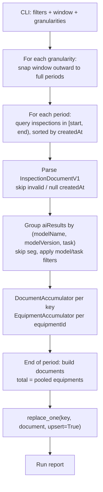

# Inspection Statistics — Documentation

Reads **inspection documents** from MongoDB and writes **pre-aggregated statistics** of
the AI results into the `inspectionStatistics` collection on the same server. The
documents are meant to be read by the data drift tool instead of scanning `inspections`.

---

## 1. What was implemented

A self-contained Python package, built like `inspection_summarizer`. It depends only on
`pydantic` and `pymongo`; every numeric routine is pure Python.

```
inspection-summarizer/
├── stats.py                           entry point (not "statistics.py": that would shadow the stdlib module)
└── inspection_statistics/
    ├── config.py                      ← connection constants and bin definitions YOU fill in / review
    ├── cli.py                         argument parsing, verify / run commands
    ├── pipeline.py                    granularity loop, period loop, flush
    ├── aggregator.py                  the accumulators that build one document
    ├── stats_math.py                  confidence parsing, quantiles, histogram bins, std
    ├── repositories.py                read inspections, replace statistics, indexes
    ├── report.py                      run counters
    ├── db.py                          MongoDB connection (one client, two collections)
    ├── filters.py                     InspectionFilter → MongoDB query
    ├── keys.py                        the document key, aiModel split
    ├── common/
    │   ├── constants.py               ModelTasks, InspectionMode, UploadStatus, Granularity
    │   └── datetime_util.py           period start / end, window snapping, period iteration
    ├── schemas/
    │   ├── base.py                    DataModel: snake_case ↔ camelCase storage
    │   ├── inspections.py             InspectionDocumentV1 (lenient copy)
    │   └── statistics.py              InspectionStatisticsDocument and its tree
    └── tests/test_statistics.py       synthetic checks, no MongoDB
```

### Deviations from the proposal

| Topic | Proposal | Implemented | Why |
|---|---|---|---|
| `productId` | part of the key and the unique index | **not** part of the key; stored on the document as the first value seen, nullable | `productId` can be null; one period aggregates every barcode (decided in review) |
| `aiModel` split | "first `/`" | **last** `/`, via `rpartition` | matches `inspection_summarizer`, so both collections agree on `modelName`/`modelVersion` |
| `mode` | enum | plain string in the key | a mode the enum does not know still gets its own document instead of failing validation |
| `confidence`, `threshold` in the inspection schema | typed | `Any`, interpreted per prediction | lets a bad value be counted in `quality.*` instead of rejecting the whole inspection |

---

## 2. The document

### One document per key

```
modelName + modelVersion + task + mode + gbm + process + granularity + startDate
```

`startDate` is the **UTC** start of the period that contains the inspection's
`metadata.createdAt`; `endDate` is exclusive.

| granularity | example for `createdAt` = 2026-09-21 05:36 UTC (a Monday) |
|---|---|
| hourly | 05:00 → 06:00 |
| shift | 00:00 → 12:00 (12:00 → 24:00 for the afternoon) |
| daily | 2026-09-21 00:00 → 2026-09-22 00:00 |
| weekly | Mon 2026-09-21 00:00 → Mon 2026-09-28 00:00 |

Inside a document: one entry per `equipmentId` in `equipments[]`, plus `total`, which is
computed over the **pooled raw values** of every equipment, so its quantiles are exact,
not an approximation from the per-equipment ones.

### Fan-out

One inspection contributes to one document per distinct `(modelName, modelVersion, task)`
in its `aiResults`, per granularity. If the same `aiModel` appears twice in one inspection,
both entries' predictions count and `inspectionCount` still counts the document once.
`seg` results are skipped.

### Units

| | cls | det |
|---|---|---|
| `predictionCount` | images | images |
| `boxCount` | `null` | boxes |
| `confidence`, `classCounts`, `perClass` | one value per prediction | one value per box |
| `elapsedTime` | per prediction | per prediction (image) |
| `images` | `null` | image-level box statistics |

### Rules per field

| Field | Rule |
|---|---|
| confidence of one prediction | `max(confidence)` for a list, the value itself for a number |
| `quality.missingConfidenceCount` | `null` or empty list |
| `quality.parseErrorCount` | anything that is not a finite number or a list of them (strings, booleans, NaN) |
| `classCounts` | every prediction/box counts under its predicted class, **even if its confidence is invalid**; every name in `classes` appears, with `0` when unseen; a predicted class the model never declared is appended to `classes` |
| `perClass` | one `ConfidenceStats` per name in `classes` (empty stats and a zero histogram when unseen) |
| `belowThresholdCount` / `nearThresholdCount` | each confidence is compared against **its own prediction's** `threshold`; `null` when no prediction in the block had one |
| `perClass[c].threshold` | both tasks: last non-null threshold seen for that predicted class (cls: `prediction.threshold`, det: the box's `threshold`); documents are read oldest-first. In `total`, `null` if the equipments disagree. There is no equipment-level threshold |
| `backend` | last value seen |
| `classes` | ordered union of `aiResults[].classes`, first-seen order |
| `localTimezone`, `productId` | first value seen; a later disagreement on `localTimezone` is reported once |
| `location` | inside each equipment entry, first value seen; disagreement reported once |
| `histogram` | counts per bin of `bins.confidenceEdges`; the last bin is closed, values outside `[0, 1]` clamp to the edge bins |
| `quantiles` | linear interpolation between order statistics (numpy default) |
| `std` | population standard deviation, which is what `sum`, `sumSq`, `count` reproduce after combining documents |
| `images.boxesPerImage.histogram` | bins `0, 1, ..., boxesPerImageMax-1, boxesPerImageMax+` |
| `images.boxesPerImageByClass[c]` | `classCounts[c] / predictionCount` |
| floats | rounded to `ROUND_DIGITS` (6) |
| `computedAt` | UTC time of the flush |

### Additivity

`count`, `sum`, `sumSq`, `histogram`, `classCounts`, `belowThresholdCount`,
`nearThresholdCount`, `inspectionCount`, `predictionCount`, `boxCount`, `quality.*`,
`images.noBoxCount`, `images.boxesPerImage.{sum,sumSq,histogram}` are exact sums of the
hourly documents; `min`/`max` combine by min/max; `mean`/`std` follow from the sums. The
test suite asserts this for a synthetic two-day dataset. Only `quantiles` need the raw
values, which is why every granularity is computed from `inspections` and not rolled up.

---

## 3. Workflow



**Why full recomputation.** Quantiles and histograms cannot be folded from partial
results, so a document is always rebuilt from every inspection of its period and then
**replaces** the stored one. That makes a run idempotent with no bookkeeping: rerunning
the same window rewrites byte-identical documents (except `computedAt`).

**Why the window is snapped.** A half-covered period would produce a document missing
half its data, and it would overwrite a complete one. So `--start 2026-09-21T04:30
--end 2026-09-21T06:10` reads `04:00–07:00` for `hourly`, `00:00–12:00` for `shift`, the
whole day for `daily` and the whole week for `weekly`. The `run` command prints every
snapped window and its document count before asking for confirmation.

**Memory.** Bounded by one period of one granularity: the raw confidences are held as
compact float arrays and released after the flush. A week of one line is a few million
floats at most.

**Existence.** A document is written only for a period that had at least one matching
inspection. A stored document whose inspections have since disappeared (for example
marked `isDeleted`) is left alone; this tool never deletes.

**Partial documents.** Filters that are not part of the key (`--equipment-id`,
`--location`, `--product-id`, `--local-timezone`, `--conclusion`, `--upload-status`) and
`--limit` produce documents that cover only a subset; the CLI warns loudly. The next run
over the same periods replaces them wholesale.

---

## 4. How to run

### Step 1 — Install

```bash
pip install -r inspection_statistics/requirements.txt
```

Requires Python 3.11 or newer.

### Step 2 — Fill in the constants

Edit `inspection_statistics/config.py`:

```python
MONGO_HOST = "10.0.0.11"
MONGO_PORT = 27017
MONGO_USERNAME = "writer"        # leave "" if no authentication
MONGO_PASSWORD = "..."
MONGO_AUTH_SOURCE = "admin"
MONGO_REPLICA_SET = ""           # leave "" for a standalone instance
DB_NAME = "cosmo"
INSPECTIONS_COLLECTION = "inspections"
STATISTICS_COLLECTION = "inspectionStatistics"
```

Bin definitions live in the same file (`CONFIDENCE_EDGES`, `NEAR_THRESHOLD_MARGIN`,
`BOXES_PER_IMAGE_MAX`) and are copied into every document under `bins`. Changing them
changes the meaning of every histogram: regenerate the collection if you do.
`RETENTION_SECONDS` (one year) drives the TTL index.

### Step 3 — Verify

```bash
python stats.py verify
```

Read-only. Pings the server, prints both collections' document counts, the existing
indexes on the statistics collection, and one raw inspection document.

### Step 4 — Dry run

```bash
python stats.py run --start 2026-09-21 --end 2026-09-22 --gbm SEHC --process Side --dry-run
```

Prints the filters, the snapped window and match count per granularity, and one line per
document that would be written.

### Step 5 — Real run

```bash
python stats.py run --start 2026-09-21 --end 2026-09-22 --gbm SEHC --process Side
```

Without `--yes` you get a confirmation prompt. Indexes are created on the first real run.

---

## 5. Command reference

```
python stats.py [--log-level {DEBUG,INFO,WARNING,ERROR}] {verify,run} ...
```

### `run`

**Time window — required.** Half-open UTC range on `metadata.createdAt`, snapped outward
to complete periods per granularity.

| Flag | Meaning |
|---|---|
| `--start` | Inclusive start (`2026-09-21` or `2026-09-21T04:30`) |
| `--end` | Exclusive end |
| `--granularity` | One or more of `hourly shift daily weekly`. Default: all four |

**Metadata filters.** Optional; several values to one flag become an `$in`.

| Flag | Matches | In the key? |
|---|---|---|
| `--gbm` | `metadata.gbm` | yes |
| `--process` | `metadata.process` | yes |
| `--mode` | `metadata.mode` | yes |
| `--location` | `metadata.location` | no → partial documents |
| `--equipment-id` | `metadata.equipmentId` | no → partial documents |
| `--product-id` | `metadata.productId` | no → partial documents |
| `--local-timezone` | `metadata.localTimezone` | no → partial documents |

**Result filters.**

| Flag | Matches | In the key? |
|---|---|---|
| `--ai-model` | full `aiModel` string | yes |
| `--model-name` | part before the last slash | yes |
| `--task` | `cls`, `det` (`seg` never produces a document) | yes |
| `--conclusion` | `inspectionResults.conclusion` | no → partial documents |
| `--upload-status` | `completed`, `processing` | no → partial documents |
| `--include-deleted` | include `isDeleted: true` (excluded by default) | – |

`--ai-model`, `--model-name` and `--task` are applied twice: in the query to select
documents, and again per `aiResult` in Python, so that the other models inside a matched
document are not aggregated.

**Execution.**

| Flag | Default | Meaning |
|---|---|---|
| `--batch-size` | 500 | Cursor batch size |
| `--limit` | – | Stop after this many inspection documents **per granularity pass**; documents become partial |
| `--dry-run` | off | Compute everything, write nothing |
| `--yes` | off | Skip the confirmation prompt |
| `--report-json PATH` | – | Write the run report as JSON |

### Examples

Nightly job — yesterday, every granularity, no prompt (the weekly document is refreshed each night):

```bash
python stats.py run --start 2026-09-21 --end 2026-09-22 --gbm SEHC --yes --report-json /var/log/stats/2026-09-21.json
```

Rebuild one model's hourly documents for a week:

```bash
python stats.py run --start 2026-09-14 --end 2026-09-21 --model-name sidebottom --granularity hourly
```

---

## 6. Reading the run report

```
Run COMPLETED
  granularities processed   : 4
  periods processed         : 33      ← 24 hourly + 2 shift + 1 daily + 1 weekly ... per snapped window
    empty (no document)     : 9       ← periods with no matching inspection
  inspections read          : 3240    ← the same inspection is read once per granularity
    invalid (skipped)       : 0
    no createdAt (skipped)  : 0
  aiResults seen            : 9720
    filtered out            : 0
    seg (skipped)           : 3240
  predictions counted       : 51840
    boxes (det)             : 12960
    missing confidence      : 0
    parse errors            : 0
  documents created         : 48
  documents updated         : 0
  documents written         : 48
    failed                  : 0
  windows actually read (snapped to full periods):
      hourly : [2026-09-21T00:00:00, 2026-09-22T00:00:00)
      shift  : [2026-09-21T00:00:00, 2026-09-22T00:00:00)
      daily  : [2026-09-21T00:00:00, 2026-09-22T00:00:00)
      weekly : [2026-09-21T00:00:00, 2026-09-28T00:00:00)
```

On a rerun of the same window expect `documents updated` to equal `documents written`.
A `metadata conflicts` section lists first-writer-wins disagreements on `localTimezone`
or an equipment's `location`, once per field per document.

---

## 7. Indexes

Created by the first real run (`StatisticsRepository.ensure_indexes`):

| Name | Keys | Notes |
|---|---|---|
| `statistics_key_unique` | `modelName, modelVersion, task, mode, gbm, process, granularity, startDate` | unique; its prefix is the drift tool's main query |
| `site_granularity_startDate` | `gbm, process, granularity, startDate` | "which models ran on this line last week" |
| `equipment_granularity_startDate` | `equipments.equipmentId, granularity, startDate` | multikey, equipment lookup across models |
| `startDate_ttl` | `startDate` | TTL, `expireAfterSeconds = RETENTION_SECONDS` |

---

## 8. Operational notes

**Do not run two overlapping jobs at once.** Each document is a full replacement, so two
concurrent runs over the same period simply race; the last writer wins with a complete
document, but there is no protection against a partial-filter run overwriting a full one.

**Reruns are cheap and safe.** Recomputing a week rewrites identical documents. Use that
after a model is re-labelled, after `isDeleted` flags change, or after the bins change
(then regenerate everything).

**Size.** A cls document with 2 classes and 10 equipments is about 25 KB; a det document
with 30 classes about 200 KB. Readers should project `total` or one equipment entry
rather than the whole document.

**Timezone.** Boundaries are UTC. `localTimezone` is stored so a reader can translate
them into a factory shift when explaining a result.

---

## 9. Verification performed

`inspection_statistics/tests/test_statistics.py`, synthetic data only:

- Period boundaries for `2026-09-21 05:36`: hourly `05:00–06:00`, shift `00:00–12:00`,
  daily, weekly Monday-to-Monday; afternoon shift and Sunday-night week membership.
- Window snapping, including an end already on a boundary.
- Confidence parsing: list → max, number, empty/null → missing, string/bool/NaN → error.
- Quantile interpolation and histogram bins including the closed last bin and clamping.
- Classification document: per-equipment and total counts, histogram, own-threshold
  below/near counts, zero entries for unseen declared classes, appended undeclared class,
  last-seen per-class threshold and backend, exact pooled quantiles/mean/std in `total`.
- Detection document: box vs image counts, `images.*`, per-class thresholds, `total`
  dropping a per-class threshold when equipments disagree.
- Same `aiModel` twice in one inspection: both count, one inspection.
- First-writer-wins conflicts reported once per field.
- End-to-end pipeline against in-memory fakes: documents only for populated periods,
  one document per (model, task, mode), seg skipped, deleted excluded, unknown mode kept,
  idempotent rerun, and the exact additivity of the five hourly documents of a day into
  the daily one for every additive field.
